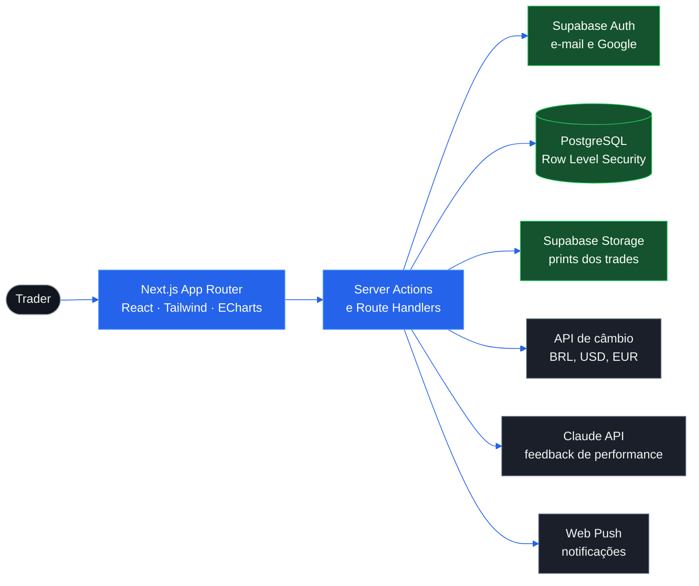

<a href="https://portfolio-orcin-nine-x51rqo3inw.vercel.app">
<picture>
  <source media="(prefers-color-scheme: dark)" srcset="assets/banner.svg">
  <source media="(prefers-color-scheme: light)" srcset="assets/banner-light.svg">
  
</picture>
</a>

 

   

 

## Projetos

 &nbsp;  &nbsp; 

**Debrief** é um SaaS onde traders registram cada operação com o contexto que justificou
a entrada e descobrem, nos próprios números, o que funciona no seu operacional.
Contas em BRL, USD e EUR com cotação ao vivo, calculadora de resultado com câmbio
embutido, prints e notas em cada trade, tags por estratégia, calendário de PNL,
feedback de IA sobre o histórico, exportação em PDF e notificações push.

> [!NOTE]
> Produto comercial em desenvolvimento, por isso o repositório é privado.
> O app está no ar e aberto para uso. Antes se chamava Liquid Journal.

<b>Registro de um trade, do ativo ao PNL</b> · GIF de 27s

 

Buscar o ativo · informar entrada e saída · a calculadora fecha o PNL na moeda da conta · anexar o print e as notas · salvar e ver o dashboard se atualizar

<b>Como ele é montado</b>

 

Cada trader só enxerga as próprias operações, e isso é garantido no banco
por Row Level Security — não por uma checagem na aplicação que alguém possa
esquecer de escrever.

 

 &nbsp;  &nbsp; 

**Constela & Órion** é uma plataforma de estudos gamificada em pixel art. Agenda
semanal com arrastar e soltar, edital com o progresso de cada assunto, quizzes
com explicação, simulados no tempo da prova e flashcards com repetição espaçada
(FSRS). São dois universos trocáveis, cada um com mascote, paleta e céu animado
próprios, a abelhinha Constela e o Ori, o axolote. Tudo funciona sem internet e
sincroniza com a conta quando ela existe. XP e conquistas premiam a constância
sem punir o dia perdido.

> [!NOTE]
> Projeto pessoal, por isso o repositório é privado e o app ainda não está
> publicado. O GIF abaixo é o app real, com dados de demonstração.

<b>Da abertura ao estudo, nos dois universos</b> · GIF de 26s

 

Intro com o toca aqui · escolher o parceiro, que prepara o app · o céu da página inicial · concluir uma sessão e ganhar XP · o Ori assume o controle e repinta tudo

<b>Como ele é montado</b>

 

Local-first: cada tela lê e grava no próprio aparelho e funciona sem internet.
Com conta, a sincronização roda em segundo plano, e o Row Level Security garante
que cada pessoa só enxerga os próprios dados. Quem não tem conta nem baixa o
Supabase, e o JavaScript inicial de cada tela fica entre 210 e 275 KB.

 

<table>
<tr>
<td width="33.33%" valign="top">

  <b>Next.js · TypeScript · Tailwind</b> 
  <a href="https://cinesol-cinema.vercel.app"><b>Ver demo</b></a>
  &nbsp;·&nbsp;
  <a href="https://github.com/joaotabosa3599/cinesol-cinema">código</a>

</td>
<td width="33.33%" valign="top">

  <b>React · Vite · JavaScript</b> 
  <a href="https://anabijus-ecommerce.vercel.app"><b>Ver demo</b></a>
  &nbsp;·&nbsp;
  <a href="https://github.com/joaotabosa3599/anabijus-ecommerce">código</a>

</td>
<td width="33.33%" valign="top">

  <b>React · TypeScript · Tailwind · Framer Motion</b> 
  <a href="https://portfolio-orcin-nine-x51rqo3inw.vercel.app"><b>Ver site</b></a>
  &nbsp;·&nbsp;
  <a href="https://github.com/joaotabosa3599/portfolio">código</a>

</td>
</tr>
</table>

 

## Stack

<table align="center">
<tr>
<td align="center" valign="top" width="25%">

**Interface**

 

</td>
<td align="center" valign="top" width="25%">

**Servidor e dados**

 

</td>
<td align="center" valign="top" width="25%">

**Mobile**

</td>
<td align="center" valign="top" width="25%">

**Testes e deploy**

</td>
</tr>
</table>

<b>Também trabalho com</b>

 

Java e C, da graduação em Engenharia da Computação. Estruturas de dados,
processamento de texto e um sistema de gestão de funcionários estão nos
repositórios públicos.

 

## Estudando agora

Quero desenhar de onde o dado vem, não só consumi-lo.

<table>
<tr>
<td align="center" width="33.33%">🧭 <b>Arquitetura de API REST</b></td>
<td align="center" width="33.33%">🗂️ <b>Modelagem relacional</b></td>
<td align="center" width="33.33%">🔐 <b>Row Level Security no Postgres</b></td>
</tr>
</table>

 

<picture>
  <source media="(prefers-color-scheme: dark)" srcset="https://streak-stats.demolab.com/?user=joaotabosa3599&hide_border=true&border_radius=16&background=15171C&stroke=2B2E36&ring=7F5AF5&fire=5EEAD4&currStreakNum=F5F5F5&sideNums=F5F5F5&currStreakLabel=A48BFB&sideLabels=9A9CA3&dates=64666D&date_format=j%20M%5B%20Y%5D">
  <source media="(prefers-color-scheme: light)" srcset="https://streak-stats.demolab.com/?user=joaotabosa3599&hide_border=true&border_radius=16&background=FFFFFF&stroke=E5E7EB&ring=7F5AF5&fire=0891B2&currStreakNum=111318&sideNums=111318&currStreakLabel=7F5AF5&sideLabels=64666D&dates=9A9CA3&date_format=j%20M%5B%20Y%5D">
  
</picture>

